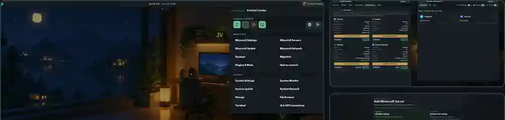
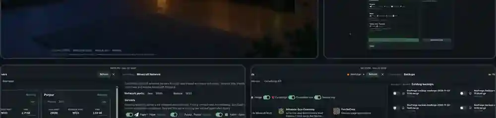

  

  <a href="../README.md">English</a> •
  <a href="README_fr-CA.md">Français (Canada)</a> •
  <a href="README_fr-FR.md">Français (France)</a> •
  <a href="README_de.md">Deutsch</a> •
  <a href="README_pl.md">Polski</a> •
  <a href="README_pt-BR.md">Português (Brasil)</a> •
  <a href="README_es-419.md">Español (Latinoamérica)</a> •
  <a href="README_es-ES.md">Español (España)</a> •
  <a href="README_it.md">Italiano</a> •
  <a href="README_nl.md">Nederlands</a> •
  <a href="README_sv.md">Svenska</a> •
  <a href="README_nb.md">Norsk Bokmål</a> •
  <a href="README_da.md">Dansk</a> •
  <a href="README_tr.md">Türkçe</a> •
  <a href="README_id.md">Bahasa Indonesia</a> •
  <a href="README_uk.md">Українська</a> •
  <a href="README_ru.md">Русский</a> •
  <a href="README_zh-Hans.md">简体中文</a> •
  <a href="README_zh-Hant.md">繁體中文</a> •
  <a href="README_ja.md">日本語</a> •
  <a href="README_ko.md">한국어</a>

<!-- justvoxel-translation-notice -->

> **번역 안내:** 이 JustVoxel 번역은 기준이 되는 영어 원문을 바탕으로 AI의 도움을 받아 작성했습니다. 부정확하거나 이해하기 어렵거나 어색한 표현을 발견하면 GitHub에 [이슈](https://github.com/home-server-project/justvoxel/issues) 또는 [풀 리퀘스트](https://github.com/home-server-project/justvoxel/pulls)를 올려 수정안을 제안해 주세요.

  <strong>보유한 장비, 임대한 전용 서버, 호스팅 VM에서 나만의 Minecraft 서버를 운영하세요. 관리는 하나의 제어 센터에서 할 수 있습니다.</strong>

  운영체제 관리에 신경 쓰지 않고 Minecraft 서버를 직접 운영하려는 사람을 위한 자체 호스팅 서버 어플라이언스입니다.

  <a href="#-justvoxel-설치">설치</a> •
  <a href="#-더-쉬운-minecraft-호스팅">기능</a> •
  <a href="../docs/INSTALLER.md">문서</a>

  

JustVoxel은 직접 호스팅할 수 있는 Minecraft 전용 서버 어플라이언스입니다. 호환되는 PC, 노트북, 물리 서버, 가상 머신 또는 원하는 OS 이미지를 실행할 수 있는 호스팅 서비스에 설치한 뒤 브라우저에서 Minecraft를 관리하세요.

여러 스크립트를 유지 관리하거나 별도의 Minecraft 관리 패널을 설치할 필요가 없습니다.

오래된 노트북이나 PC가 있나요? **JustVoxel HWS를 설치하면 쓰지 않고 보관해 둔 장비를 Minecraft 전용 어플라이언스로 활용할 수 있습니다.** 지원되는 노트북에서는 덮개를 닫아도 절전 모드로 전환하지 않도록 설정해 서버를 계속 실행할 수 있습니다. 로컬 콘솔의 화면을 즉시 끄거나 잠시 후에 끄는 기능도 제공됩니다.

> 🚧 **사전 릴리스:** JustVoxel은 첫 공개 릴리스를 준비 중입니다. 최종 릴리스 검증이 진행되는 동안 현재 설치 ISO를 테스트하거나 미리 사용해 볼 수 있습니다.

## ✨ 더 쉬운 Minecraft 호스팅

JustVoxel은 Minecraft 관리 기능과 이를 실행하는 운영체제를 하나로 묶습니다.

- 🎮 **여러 Minecraft 서버** — 하나의 어플라이언스에서 서로 다른 월드와 서버 유형을 독립적으로 운영합니다.
- 🖥️ **웹 제어 센터** — 컴퓨터, 태블릿, 휴대폰에서 서버를 관리합니다.
- 🧩 **플러그인 및 모드** — 지원되는 제공업체에서 호환 콘텐츠를 찾아 관리합니다.
- 💾 **백업 및 복원** — 예약 백업과 수동 백업으로 서버별 데이터를 보호합니다.
- 🌐 **원격 접근** — 통합된 비공개 네트워크 및 게임 터널링 옵션 네 가지 중에서 선택합니다.
- 🤖 **AI 및 자동화** — MCP와 REST를 통해 호환되는 AI 어시스턴트와 애플리케이션을 연결합니다.
- 💬 **Telegram 및 Discord** — 봇을 통한 제어, 알림, 커뮤니티 기능을 필요에 따라 사용합니다.
- 🛡️ **시스템 관리** — Linux 명령어를 배우지 않아도 네트워크, 저장소, 업데이트, 시스템 상태, 로그 및 지원되는 전원 기능을 관리할 수 있습니다.

JustVoxel은 가족, 친구, 소규모 Minecraft 커뮤니티와 기존 호스팅의 Minecraft 관리 패널을 빌려 쓰는 대신 자체 서버를 운영하려는 사람을 위해 설계되었습니다.

## 🖥️ 하나의 어플라이언스, 두 가지 에디션

### JustVoxel VM

다음과 같은 가상 머신 및 호스팅 환경에 적합합니다.

- Proxmox
- KVM / libvirt
- VMware
- Hyper-V
- VirtualBox
- 호환되는 사용자 지정 OS 이미지를 허용하는 호스팅 VM 또는 VPS 상품

VM 에디션은 가상 머신에 불필요한 물리 하드웨어용 패키지를 제외하고 Minecraft 어플라이언스의 모든 기능을 제공합니다.

### JustVoxel HWS

다음과 같은 물리 장비에 직접 설치할 수 있습니다.

- 오래된 노트북
- 용도를 바꿔 쓰는 데스크톱
- 미니 PC
- 홈 서버
- 사용자 지정 설치 미디어를 허용하는 임대 베어메탈 서버

HWS는 UPS/NUT 연동, SMART 및 NVMe 도구, 센서, 펌웨어 및 UEFI 제어, 장치 펌웨어, 하드웨어 진단, 노트북 화면 및 덮개 제어 등 물리 장비용 기능을 추가로 제공합니다.

두 에디션은 동일한 JustVoxel 제어 센터, Management API, Minecraft 관리 절차, 저장소 구성 방식, 백업, 네트워크 및 업데이트 기능을 제공합니다.

[VM 및 HWS의 지원 기능 알아보기](../docs/VARIANTS.md)

## 🚀 JustVoxel 설치

하나의 설치 ISO에서 두 JustVoxel 에디션을 모두 지원합니다.

[⬇️ JustVoxel x86_64 ISO 다운로드](https://sourceforge.net/projects/justvoxel/files/JustVoxel-x86_64.iso/download)

**부팅용 USB 만들기:** [balenaEtcher](https://etcher.balena.io/), [Rufus](https://rufus.ie/en/), [Ventoy](https://www.ventoy.net/en/index.html), [Fedora Media Writer](https://fedoraproject.org/workstation/download/) 또는 디스크 이미지를 직접 기록할 수 있는 다른 도구를 사용해 ISO를 USB 드라이브에 기록하세요. Linux 및 기타 유닉스 계열 시스템에서는 `dd`를 사용하는 전통적인 방법도 사용할 수 있습니다. 이미지를 USB 드라이브에 직접 기록하면 드라이브의 모든 데이터가 지워집니다.

설치 환경에 맞는 에디션을 선택하세요.

- 가상 머신 및 호환되는 VM 호스팅 환경에는 **JustVoxel VM**
- PC, 노트북, 미니 PC, 물리 홈 서버 및 호환되는 베어메탈 호스팅 환경에는 **JustVoxel HWS**

설치, 디스크 준비, 첫 로그인에 관한 자세한 내용은 [설치 가이드](../docs/INSTALLER.md)를 참고하세요.

## 🏠 Minecraft 중심의 어플라이언스를 홈 서버로도 활용

JustVoxel은 Minecraft 서버 어플라이언스를 중심으로 개발 및 지원됩니다. 기반 시스템은 **Podman, Quadlet, systemd, SSH, NetworkManager 및 표준 Linux 관리 도구를 갖춘 일반 AlmaLinux 10 bootc 서버**입니다.

고급 사용자는 같은 장비를 홈 서버로 활용해 Minecraft와 함께 다른 컨테이너를 실행할 수 있습니다.

예를 들어 다음과 같은 서비스를 직접 배포할 수 있습니다.

- 미디어용 **Jellyfin** 또는 **Plex**
- 비밀번호 관리용 **Vaultwarden**
- 사진 및 동영상 관리용 **Immich**
- 홈 자동화용 **Home Assistant Container**
- 파일 관리 및 협업용 **Nextcloud**
- **Syncthing** 또는 **Navidrome**
- 자체 호스팅 AI 에이전트 및 게이트웨이용 **OpenClaw**

이러한 애플리케이션은 **JustVoxel 제어 센터에서 관리하지 않습니다**. 관련 Podman 컨테이너, Quadlet, 저장소, 포트, 업데이트, 백업, 리버스 프록시 설정 및 애플리케이션별 요구 사항은 관리자가 직접 관리합니다.

JustVoxel은 Minecraft 어플라이언스를 관리합니다. 고급 사용자는 그 밖의 작업에 일반적인 Podman 및 Quadlet 관리 방식을 그대로 사용할 수 있습니다.

유지 관리 작업에서도 Minecraft와 무관한 컨테이너는 관리자 소유의 워크로드로 취급합니다. Minecraft의 **처음부터 다시 시작** 같은 작업은 관련 없는 Podman 컨테이너를 삭제하지 않습니다.

따라서 JustVoxel 장비를 주로 Minecraft 어플라이언스로 쓰면서 필요에 따라 일반적인 컨테이너 기반 홈 서버로 활용할 수 있습니다.

## 🎮 원하는 Minecraft 서버 만들기

장비에 메모리와 사용 가능한 포트가 충분하면 JustVoxel에서 여러 개의 독립된 Minecraft 서버를 동시에 실행할 수 있습니다.

각 서버에는 고유 ID, 구성, 런타임, 포트, 데이터, 백업, 수명 주기 제어 기능 및 상태 정보가 있습니다.

### 현재 지원하는 서버 소프트웨어

| 서버 소프트웨어 | 콘텐츠 유형 | 관리형 Java → Bedrock 크로스플레이 |
| --- | --- | --- |
| **Paper** | 플러그인 | ✅ |
| **Purpur** | 플러그인 | ✅ |
| **Spigot** | 플러그인 | ✅ |
| **Pufferfish** | 플러그인 | ✅ |
| **Leaf** | 플러그인 | ✅ |
| **Fabric** | 모드 | ✅ 정확한 호환성이 확인된 경우 |
| **NeoForge** | 모드 | ✅ 정확한 호환성이 확인된 경우 |
| **Forge** | 모드 | Java 전용 |
| **Quilt** | 모드 | Java 전용 |
| **Vanilla Java** | 플러그인 및 모드 미지원 | Java 전용 |
| **네이티브 Bedrock** | 네이티브 Bedrock 서버 | 네이티브 Bedrock 클라이언트 |

첫 서버를 안내에 따라 만들려면 **간편 설정**을 선택하세요. 메모리, 포트, 저장소, 백업, 버전 정책 및 호환되는 크로스플레이 옵션을 더 세밀하게 지정하려면 **고급 설정**을 선택하세요.

JustVoxel은 선택한 서버 소프트웨어에서 각 기능을 사용할 수 있는지 확인합니다.

[서버 소프트웨어 및 호환성 상세 정보 보기](../docs/server-software.md)

## 🧩 플러그인 및 모드

선택한 서버에서 **Minecraft → 플러그인 및 모드**를 여세요.

서버 유형에 따라 다음 서비스를 이용할 수 있습니다.

- [Modrinth](https://modrinth.com/)
- [Hangar](https://hangar.papermc.io/)
- [CurseForge](https://www.curseforge.com/minecraft) (설정한 API 키 사용)

지원되는 설치 절차에는 호환성 검사, 다운로드 검증, 서버를 중지한 상태에서의 백업, 재시작 검증, 소유권 추적 및 복구 보호 조치가 포함됩니다.

Paper 계열 서버는 플러그인 카탈로그를 사용할 수 있습니다. Fabric, Forge, NeoForge, Quilt는 모드 카탈로그를 사용하며 로더와 Minecraft 버전이 정확히 일치하는지 확인합니다. Vanilla Java와 네이티브 Bedrock은 플러그인이나 모드 카탈로그를 제공하지 않습니다.

[플러그인 및 모드 알아보기](../docs/plugin-workspace.md)

## 🌐 선택 기능인 Minecraft 네트워크

여러 독립 서버를 운영할 때는 **프록시가 필요 없습니다**.

호환되는 여러 서버를 하나의 공개 접속 지점으로 묶고 싶다면 Velocity 기반의 **Minecraft 네트워크**를 사용할 수 있습니다.

제어 센터에서 지원되는 백엔드 서버를 선택하고, 공개 Java 및 Bedrock 포트를 설정하고, 가상 로비와 환영 메시지를 관리하고, 네트워크에 참여할 서버를 지정할 수 있습니다.

Paper, Purpur, Pufferfish, Leaf는 네트워크 백엔드로 지원됩니다. 호환되는 Fabric/Quilt 및 Forge/NeoForge 서버도 JustVoxel이 필요한 프록시 호환성을 확인하면 참여할 수 있습니다. Spigot, Vanilla, 네이티브 Bedrock은 독립 서버로만 운영됩니다.

[Minecraft 네트워크 알아보기](../docs/minecraft-network.md)

## 🖥️ 제어 센터 둘러보기

JustVoxel은 Linux 내부 구조를 몰라도 서버를 관리할 수 있도록 설계되었습니다.

### Minecraft 서버

여러 서버를 만들고 관리할 수 있습니다. 서버를 시작하거나 중지하고, 상태와 플레이어를 확인하고, 지원되는 설정을 변경하거나 서버별 도구를 열 수 있습니다.

### 플러그인 및 모드

호환되는 콘텐츠를 찾고, 설치된 플러그인과 모드를 확인하고, 지원되는 콘텐츠를 추가하고 관리합니다. 변경 작업을 확인해야 할 때는 복구 정보를 볼 수 있습니다.

### 백업 및 저장소

백업을 만들고 이력을 확인하며, 서버 데이터 전체를 복원할 수 있습니다. 백업 위치 설정, 서버 가져오기 및 내보내기, 지원되는 저장소 관리도 가능합니다.

### 네트워크

이더넷, Wi-Fi, **연결 문제 해결**, 원격 접근을 관리합니다. 연결을 끊을 수 있는 네트워크 변경에는 롤백 보호가 적용됩니다. IP 또는 Wi-Fi 설정을 잘못 바꿔 접근이 끊겨도 설정을 되돌릴 수 있습니다.

### 시스템

시스템 상태, 리소스, 로그, 운영체제 업데이트, 사용자, 보안, 지원되는 전원 작업 및 HWS 전용 하드웨어 제어 기능을 확인할 수 있습니다.

### AI 및 API 연결

별도의 관리 시스템을 구축하지 않고 지원되는 AI 애플리케이션, MCP 클라이언트, REST 자동화, Telegram 및 Discord를 연결할 수 있습니다.

터미널이 더 편한가요? JustVoxel은 어플라이언스의 동일한 안전 규칙을 따르는 대화형 터미널 관리 도구 **mjust**도 제공합니다.

[WebUI 문서](../docs/WEBUI.md) · [mjust 가이드](../docs/MJUST.md)

## 🌐 친구가 접속하는 방식 선택하기

JustVoxel은 현재 **네트워크 → 원격 접근**에서 네 가지 원격 접근 옵션을 제공합니다.

이미지에 포함된 원격 접근 서비스는 JustVoxel에서 바로 사용할 수 있도록 통합되어 있습니다. 서비스별로 지원되는 상태 확인, 활성화와 비활성화, 설정 절차를 제공합니다.

| 옵션 | 적합한 용도 | 제공 기능 |
| --- | --- | --- |
| **[Tailscale](https://tailscale.com/)** | 친구나 가족을 위한 비공개 서버 | 승인된 장치 간 비공개 메시 네트워크 |
| **[NetBird](https://netbird.io/)** | 접근을 제어하는 비공개 네트워크 | 계정과 접근 정책을 관리할 수 있는 비공개 네트워크 |
| **[Playit.gg](https://playit.gg/)** | 공유기의 일반적인 포트 포워딩 없이 Minecraft 서버 공개 | 공개 게임 터널 및 접속 주소 |
| **[NordVPN Meshnet](https://meshnet.nordvpn.com/)** | NordVPN 사용자의 장치 간 비공개 접근 | JustVoxel을 상용 VPN 클라이언트로 사용하지 않고 Meshnet에 연결 |

### 어떤 옵션을 선택해야 하나요?

**🎮 친구가 사설 VPN 클라이언트를 설치하지 않고 접속하게 하고 싶나요?**  
먼저 **Playit.gg**를 살펴보세요. 플레이어는 설정된 게임 터널의 공개 주소로 접속할 수 있습니다.

**🔒 신뢰할 수 있는 장치만 접속할 수 있는 비공개 서버를 원하나요?**  
**Tailscale** 또는 **NetBird**를 고려하세요.

**🌍 이미 NordVPN Meshnet을 사용하고 있나요?**  
JustVoxel에서 Meshnet 연동을 관리할 수 있습니다. 이 기능은 어플라이언스를 일반 상용 NordVPN 출구 서버에 연결하는 기능과 별개입니다.

서비스 계정, 클라우드 측 정책, 터널 구성은 해당 서비스에서 관리합니다. JustVoxel은 어플라이언스 측에서 지원되는 연동을 처리합니다.

여러 VPN이나 메시 제품을 동시에 사용할 수 있지만 라우팅, DNS 또는 방화벽 규칙이 충돌할 수 있습니다.

[네트워크 및 원격 접근 가이드 읽기](../docs/NETWORKING.md)

## 🤖 AI, MCP, REST 및 자동화

AI 어시스턴트에게 서버 상태를 물어보거나, 홈 자동화를 연결하거나, 나만의 제어 흐름을 만들고 싶나요?

JustVoxel은 **AI 및 API 연결**에서 내장 **MCP 및 REST 인터페이스**를 제공합니다.

설정 화면에서 다음과 같은 호환 애플리케이션 및 연결 유형을 선택할 수 있습니다.

- **OpenAI — ChatGPT 및 Codex**
- **Claude**
- **Grok**
- **Gemini**
- **GitHub Copilot**
- **기타 AI / MCP 앱**
- **자동화 / REST API**

각 연결에서 접근할 수 있는 범위를 직접 정할 수 있습니다.

**레벨 1 — 읽기 전용**부터 서버 관리 권한까지 설정할 수 있습니다. 고급 시스템 제어 권한은 명시적으로 승인한 경우에만 부여할 수 있습니다. 연결 범위를 선택한 Minecraft 서버로 제한할 수도 있습니다.

JustVoxel의 MCP 또는 REST 인터페이스를 제공하는 데 AI 모델 API 키가 필요하지는 않습니다. 실제 사용 가능 여부는 클라이언트 애플리케이션, 계정이나 구독에서 제공하는 기능 및 네트워크 접근 여부에 따라 달라집니다.

AI/API 게이트웨이는 기본적으로 비활성화되어 있으며 직접 활성화해야 사용할 수 있습니다.

[AI 및 API 연결 알아보기](../docs/AI-API-CONNECTIONS.md)

## 💬 Telegram 및 Discord

JustVoxel에는 필요에 따라 사용할 수 있는 Telegram 및 Discord 연동이 내장되어 있습니다. 두 연동 모두 WebUI와 동일한 관리 백엔드를 사용해 작업을 처리합니다.

### Telegram

전용 Telegram 봇은 다음 기능을 제공할 수 있습니다.

- 어플라이언스 및 Minecraft 상태 확인
- 서버 선택 및 플레이어 정보 확인
- 승인된 관리 사용자의 서버 시작, 중지 및 재시작
- 수동 백업
- Minecraft 및 컨테이너 업데이트 검토
- OS 업데이트 정보 확인
- 정해진 절차에 따른 재부팅
- 서버 상태, 백업 결과 및 업데이트 제공 여부에 대한 선택적 알림

Telegram은 별도의 **읽기 전용** 및 **서버 관리** 권한을 사용하며 AI 모델은 필요하지 않습니다.

[Telegram 설정 및 권한](../docs/TELEGRAM.md)

### Discord

Discord는 Minecraft 커뮤니티와 서버 관리에 모두 사용할 수 있습니다.

명시적으로 연결한 Discord 서버의 커뮤니티 구성원은 기본 서버 상태를 확인하고 Minecraft 접속 권한을 요청할 수 있습니다. 이 과정에서 관리 권한이 자동으로 부여되지는 않습니다.

승인된 JustVoxel Discord 관리자는 서버 시작, 중지, 재시작, 수동 백업, 업데이트 검토, Minecraft 네트워크 제어 등 지원되는 작업과 추가 고급 작업을 수행할 수 있습니다.

Discord 서버 멤버십, Minecraft 허용 목록을 통한 접속 권한, JustVoxel 관리 권한은 각각 별도로 관리됩니다.

[Discord 설정, 커뮤니티 접근 및 관리](../docs/DISCORD.md)

## 💾 백업, 복원, 저장소 및 마이그레이션

Minecraft 데이터가 어플라이언스 이미지보다 중요합니다.

JustVoxel은 Minecraft 데이터와 백업 저장소를 불변 운영체제 배포 영역 밖에 두며, 두 저장 위치를 별도로 선택할 수 있습니다.

다음과 같은 저장소를 지원합니다.

- 시스템 파일시스템
- 전용 내장 디스크
- USB 저장 장치
- 기존 로컬 파티션 및 파일시스템
- 기존 미할당 공간에 새로 만든 파티션
- NFS
- SMB/CIFS

각 서버에서 자동 및 수동 백업을 사용할 수 있습니다. 복원하면 선택한 서버의 영구 데이터 전체가 교체되며, JustVoxel 내 서버 ID와 어플라이언스 설정은 유지됩니다.

다른 장비로 서버를 옮기거나 재설치 후 서버를 이전할 때는 검토 절차가 포함된 **내보내기 / 가져오기 / 복구** 기능을 사용할 수 있습니다.

[저장소](../docs/STORAGE.md) · [복원](../docs/RESTORE.md) · [마이그레이션](../docs/MIGRATION.md)

## 🛡️ 변경 작업을 더 안전하게

JustVoxel은 어플라이언스에 정의된 작업을 제어 센터에서 안전하게 실행할 수 있도록 설계되었습니다. 지원되는 작업에는 다음과 같은 안전 규칙이 적용됩니다.

- 서비스에 영향을 줄 수 있는 작업을 하기 전에 접속 중인 플레이어 확인
- 변경 사항을 적용하기 전에 검토
- 복구가 필요한 상황에 대비해 서버를 중지한 상태에서 백업
- 서버의 고유 ID를 정확히 확인해 다른 서버로 잘못 처리하는 일 방지
- 재시작 및 실행 상태 검증
- 작업 및 복구 상태를 영구적으로 저장
- 지원되는 작업에 롤백 경로 제공
- 위험한 네트워크 변경에 NetworkManager 체크포인트 사용
- Minecraft와 운영체제의 업데이트 절차를 별도로 운영

브라우저에서 사용하는 WebUI는 특권 없이 실행되며 임의의 셸 명령을 실행하지 않습니다. 브라우저에 root 셸을 노출하지 않고, 특권이 필요한 변경은 로컬 JustVoxel Management Agent에 명시적으로 정의된 API를 통해 수행합니다.

## 🔄 Minecraft 업데이트와 별개로 진행되는 시스템 업데이트

JustVoxel은 Home Server Base 10 / AlmaLinux 10을 기반으로 하며, 이미지로 관리되는 어플라이언스입니다.

운영체제 업데이트와 Minecraft 버전, 서버 소프트웨어, 플러그인, 모드 및 컨테이너 업데이트는 서로 별도로 처리됩니다.

어플라이언스를 업데이트해도 Minecraft 버전이 자동으로 바뀌지 않으며, Minecraft 서버를 변경해도 호스트 운영체제를 다시 빌드할 필요가 없습니다.

[시스템 관리 문서](../docs/SYSTEM.md)

## 📊 JustVoxel과 다른 프로젝트 비교

JustVoxel은 기존 Minecraft 제어 패널과 성격이 다릅니다. **운영체제와 Minecraft 관리 계층을 하나의 어플라이언스로 제공합니다.**

| 기능 | **JustVoxel** | **MineOS SvelteKit** | **Crafty Controller** | **MineOS Node** |
| --- | :---: | :---: | :---: | :---: |
| 완전한 Minecraft 어플라이언스 OS | ⭐ | — | — | — |
| 여러 Minecraft 서버 운영 | ✅ | ✅ | ✅ | ✅ |
| Java 및 Bedrock 서버 지원 | ✅ | ✅ | ✅ | 🟡 Java 및 레거시 PocketMine 지원 |
| 플러그인 및 모드 검색 지원 | ✅ Modrinth, Hangar, CurseForge | ✅ Modrinth, CurseForge | — | — |
| 호스트 네트워크, 저장소 및 OS 관리 | ⭐ | — | — | — |
| 통합 비공개 접근 및 게임 터널링 | ⭐ 4개 옵션 | — | — | — |
| MCP 및 REST 기반 AI 및 자동화 게이트웨이 | ⭐ | — | — | — |
| Telegram 및 Discord 관리 기능 내장 | ⭐ | — | — | — |
| 노트북 덮개 및 화면 제어 | ✅ HWS | — | — | — |
| 이미지로 관리되는 불변 OS 업데이트 | ✅ | — | — | — |
| 터미널 관리 인터페이스 | ✅ mjust | ✅ mineos CLI/TUI | — | ✅ CLI |
| 설치 방식 | 독립형 bootc 어플라이언스 | Docker / Compose 애플리케이션 | Docker, Linux 또는 Windows에서 실행되는 제어 패널 | Linux/BSD용 Node.js 애플리케이션 |

⭐ 두드러진 기능 &nbsp;•&nbsp; ✅ 지원 &nbsp;•&nbsp; 🟡 부분 지원 또는 레거시 지원 &nbsp;•&nbsp; — 검토한 프로젝트의 핵심 문서에서 다루지 않음

**비교 최종 검토일은 2026년 11월 16일입니다.** 다른 프로젝트를 깎아내리기 위한 비교가 아닙니다. 직접 관리하고 싶은 운영체제가 이미 있다면 MineOS와 Crafty는 훌륭한 선택이 될 수 있는 Minecraft 관리 애플리케이션입니다. JustVoxel은 Minecraft 패널과 **그 기반이 되는 서버 어플라이언스**를 하나의 제품으로 관리하고 싶은 사용자를 위한 것입니다.

비교에는 각 프로젝트의 현재 문서와 저장소를 사용했습니다.

- [MineOS SvelteKit](https://github.com/freeman412/mineos-sveltekit)
- [Crafty Controller](https://craftycontrol.com/) · [소스 코드](https://gitlab.com/crafty-controller/crafty-4)
- [MineOS Node](https://github.com/hexparrot/mineos-node)

오래되었거나 공정하지 않은 비교 항목이 있다면 이슈를 등록해 주세요. JustVoxel에 불리한 정정도 환영합니다.

## 📚 문서

자세한 어플라이언스 가이드는 [문서 디렉터리](../docs/)에서 확인할 수 있습니다.

다음 문서부터 살펴보세요.

- [WebUI](../docs/WEBUI.md)
- [Minecraft 런타임](../docs/MINECRAFT_RUNTIME.md)
- [서버 소프트웨어](../docs/server-software.md)
- [플러그인 및 모드](../docs/plugin-workspace.md)
- [Minecraft 네트워크](../docs/minecraft-network.md)
- [네트워크 및 원격 접근](../docs/NETWORKING.md)
- [AI 및 API 연결](../docs/AI-API-CONNECTIONS.md)
- [Telegram](../docs/TELEGRAM.md)
- [Discord](../docs/DISCORD.md)
- [저장소](../docs/STORAGE.md)
- [복원](../docs/RESTORE.md)
- [마이그레이션](../docs/MIGRATION.md)
- [시스템 관리](../docs/SYSTEM.md)
- [mjust](../docs/MJUST.md)

이미지 개발, 테스트 및 릴리스에 대해서는 [개발자 가이드](../README-DEV.md)를 참고하세요.

## ⛏️ Minecraft 소프트웨어 및 EULA

JustVoxel은 Minecraft 서버 바이너리, Mojang 서버 소프트웨어, 미리 생성된 월드를 포함하지 **않으며**, Minecraft EULA에도 미리 동의하지 않습니다.

서버를 만들 때 관리자가 Minecraft EULA에 동의하면 JustVoxel이 선택한 서버 유형에 맞는 지원 런타임을 준비합니다.

Minecraft, Mojang 소프트웨어, Paper, Purpur, Spigot, Pufferfish, Leaf, Fabric, NeoForge, Forge, Quilt, 플러그인, 모드 및 기타 타사 구성 요소에는 각각의 라이선스 및 배포 조건이 적용됩니다.

## 📄 라이선스

JustVoxel에는 **Apache-2.0** 라이선스가 적용됩니다. [LICENSE](../LICENSE)를 참고하세요.

타사 고지 사항은 [THIRD_PARTY_NOTICES.md](../THIRD_PARTY_NOTICES.md)에서 관리합니다.
