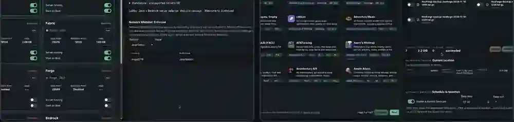

  

  <a href="../README.md">English</a> •
  <a href="README_fr-CA.md">Français (Canada)</a> •
  <a href="README_fr-FR.md">Français (France)</a> •
  <a href="README_de.md">Deutsch</a> •
  <a href="README_pl.md">Polski</a> •
  <a href="README_pt-BR.md">Português (Brasil)</a> •
  <a href="README_es-419.md">Español (Latinoamérica)</a> •
  <a href="README_es-ES.md">Español (España)</a> •
  <a href="README_it.md">Italiano</a> •
  <a href="README_nl.md">Nederlands</a> •
  <a href="README_sv.md">Svenska</a> •
  <a href="README_nb.md">Norsk Bokmål</a> •
  <a href="README_da.md">Dansk</a> •
  <a href="README_tr.md">Türkçe</a> •
  <a href="README_id.md">Bahasa Indonesia</a> •
  <a href="README_uk.md">Українська</a> •
  <a href="README_ru.md">Русский</a> •
  <a href="README_zh-Hans.md">简体中文</a> •
  <a href="README_zh-Hant.md">繁體中文</a> •
  <a href="README_ja.md">日本語</a> •
  <a href="README_ko.md">한국어</a>

<!-- justvoxel-translation-notice -->

> **Om oversettelsen:** Denne oversettelsen av JustVoxel er laget med hjelp av KI fra den engelske originalteksten. Hvis du finner en formulering som er feil, uklar eller unaturlig, kan du foreslå en rettelse ved å opprette en [sak på GitHub](https://github.com/home-server-project/justvoxel/issues) eller sende inn et [endringsforslag (pull request)](https://github.com/home-server-project/justvoxel/pulls).

  <strong>Dine Minecraft-servere på egen maskinvare, en leid dedikert server eller en virtuell maskin hos en leverandør. Alt i ett kontrollsenter.</strong>

  Et komplett Minecraft-serversystem for deg som vil drive din egen server uten å måtte administrere operativsystemet.

  <a href="#-installer-justvoxel">Installer</a> •
  <a href="#-enklere-drift-av-minecraft-servere">Funksjoner</a> •
  <a href="../docs/INSTALLER.md">Dokumentasjon</a>

  

JustVoxel er et dedikert system for å drifte egne Minecraft-servere. Installer det på en kompatibel PC, bærbar maskin, fysisk server eller virtuell maskin, eller bruk en driftstjeneste som lar deg bruke din egen operativsystemavbildning. Deretter administrerer du Minecraft fra nettleseren.

Du slipper å vedlikeholde en samling skript eller installere et eget administrasjonspanel for Minecraft.

Har du en gammel bærbar maskin eller PC? **Med JustVoxel HWS kan du gjøre den om til en dedikert Minecraft-server og ta i bruk maskinvare som ellers ville blitt liggende i en skuff.** På bærbare maskiner som støttes, kan du hindre at maskinen går i hvilemodus når du lukker lokket, slik at serveren fortsetter å kjøre. Du kan også slå av skjermen på den lokale konsollen med en gang eller etter en kort forsinkelse.

> 🚧 **Forhåndsutgave:** JustVoxel klargjøres for sin første offentlige utgivelse. Den gjeldende installasjons-ISO-en er tilgjengelig for testing og tidlig bruk mens de siste kontrollene før utgivelsen pågår.

## ✨ Enklere drift av Minecraft-servere

JustVoxel samler Minecraft-administrasjon og det underliggende operativsystemet i ett produkt.

- 🎮 **Flere Minecraft-servere** — kjør forskjellige verdener og servertyper uavhengig av hverandre på samme maskin.
- 🖥️ **Nettbasert kontrollsenter** — administrer serverne fra en datamaskin, et nettbrett eller en telefon.
- 🧩 **Plugins og modifikasjoner** — finn og administrer kompatibelt innhold fra leverandører som støttes.
- 💾 **Sikkerhetskopiering og gjenoppretting** — beskytt hver server med planlagte og manuelle sikkerhetskopier.
- 🌐 **Ekstern tilgang** — velg mellom fire integrerte løsninger for privat tilgang og spilltunneler.
- 🤖 **KI og automatisering** — koble til kompatible KI-assistenter og programmer via MCP og REST.
- 💬 **Telegram og Discord** — valgfrie botkommandoer, varsler og funksjoner for spillfellesskapet.
- 🛡️ **Systemadministrasjon** — administrer nettverk, lagring, oppdateringer, systemtilstand, logger og støttede strømfunksjoner uten å lære Linux-kommandoene som brukes under panseret.

JustVoxel er laget for familier, venner, små Minecraft-fellesskap og alle som vil eie sin egen server i stedet for å leie tilgang til et tradisjonelt kontrollpanel for Minecraft-drift.

## 🖥️ Ett serversystem, to utgaver

### JustVoxel VM

For virtuelle maskiner og driftsmiljøer som:

- Proxmox
- KVM / libvirt
- VMware
- Hyper-V
- VirtualBox
- virtuelle maskiner eller VPS-tjenester hos leverandører som tillater en kompatibel, egendefinert operativsystemavbildning

VM-utgaven inneholder hele Minecraft-serversystemet. Pakker som bare er nyttige på fysisk maskinvare, er utelatt.

### JustVoxel HWS

For installasjon direkte på fysisk maskinvare, for eksempel:

- en gammel bærbar maskin
- en stasjonær PC som tas i bruk på nytt
- en mini-PC
- en hjemmeserver
- en leid fysisk server der du kan bruke eget installasjonsmedium

HWS gir ekstra støtte for fysisk maskinvare, blant annet UPS/NUT-integrasjon, SMART- og NVMe-verktøy, sensorer, fastvare- og UEFI-funksjoner, enhetsfastvare, maskinvarediagnostikk og styring av skjerm og lokk på bærbare maskiner.

Begge utgavene bruker det samme JustVoxel-kontrollsenteret, samme Management API og de samme funksjonene for Minecraft, lagring, sikkerhetskopiering, nettverk og oppdateringer.

[Se hvilke funksjoner VM og HWS støtter](../docs/VARIANTS.md)

## 🚀 Installer JustVoxel

Samme installasjons-ISO støtter begge JustVoxel-utgavene.

[⬇️ Last ned JustVoxel x86_64 ISO](https://sourceforge.net/projects/justvoxel/files/JustVoxel-x86_64.iso/download)

Velg utgaven som passer til miljøet du installerer i:

- **JustVoxel VM** for virtuelle maskiner og kompatible VM-miljøer hos driftsleverandører
- **JustVoxel HWS** for PC-er, bærbare maskiner, mini-PC-er, fysiske hjemmeservere og kompatible leide fysiske servere

Se [installasjonsveiledningen](../docs/INSTALLER.md) for installasjon, klargjøring av disk og første pålogging.

## 🏠 Bygd for Minecraft, med plass til andre tjenester

JustVoxel er utviklet og støttet primært som et Minecraft-serversystem. Under ligger en vanlig **AlmaLinux 10 bootc-server med Podman, Quadlet, systemd, SSH, NetworkManager og standardverktøy for Linux-administrasjon**.

Erfarne brukere kan bruke samme maskin som en mer allsidig hjemmeserver og kjøre andre containere ved siden av Minecraft.

Du kan for eksempel sette opp slike tjenester manuelt:

- **Jellyfin** eller **Plex** for medier
- **Vaultwarden** for passordadministrasjon
- **Immich** for bilder og videoer
- **Home Assistant Container** for hjemmeautomatisering
- **Nextcloud** for filer og samarbeid
- **Syncthing** eller **Navidrome**
- **OpenClaw** som KI-agent eller gateway du drifter selv

Disse programmene **administreres ikke fra JustVoxel-kontrollsenteret**. Administratoren har selv ansvar for Podman-containere, Quadlet-konfigurasjon, lagring, porter, oppdateringer, sikkerhetskopier, oppsett av omvendt proxy og kravene til hvert program.

JustVoxel administrerer Minecraft-serversystemet. For andre tjenester kan erfarne brukere fortsatt bruke Podman og Quadlet på vanlig måte.

Ved vedlikehold behandler JustVoxel andre containere som tjenester administratoren selv har satt opp. Minecraft-handlinger som **Start på nytt fra begynnelsen** lar disse Podman-containerne være i fred.

Dermed kan en JustVoxel-maskin primært brukes som Minecraft-server og samtidig fungere som en vanlig containerbasert hjemmeserver ved behov.

## 🎮 Opprett Minecraft-serveren du vil ha

JustVoxel kan kjøre flere uavhengige Minecraft-servere samtidig så lenge maskinen har nok minne og ledige porter.

Hver server har sin egen identitet og konfigurasjon, sitt eget kjøremiljø og egne porter, data og sikkerhetskopier. Du kan se status og styre livssyklusen for hver server separat.

### Serverprogramvare som støttes nå

| Serverprogramvare | Type innhold | Administrert krysspill (Java → Bedrock) |
| --- | --- | --- |
| **Paper** | Plugins | ✅ |
| **Purpur** | Plugins | ✅ |
| **Spigot** | Plugins | ✅ |
| **Pufferfish** | Plugins | ✅ |
| **Leaf** | Plugins | ✅ |
| **Fabric** | Modifikasjoner | ✅ Når nøyaktig kompatibilitet er bekreftet |
| **NeoForge** | Modifikasjoner | ✅ Når nøyaktig kompatibilitet er bekreftet |
| **Forge** | Modifikasjoner | Bare Java |
| **Quilt** | Modifikasjoner | Bare Java |
| **Vanilla Java** | Ingen plugins eller modifikasjoner | Bare Java |
| **Innebygd Bedrock** | Innebygd Bedrock-server | Direkte tilkobling fra Bedrock-klienter |

Velg **Enkelt oppsett** for å bli veiledet gjennom oppsettet av den første serveren, eller **Avansert oppsett** for mer kontroll over minne, porter, lagring, sikkerhetskopiering, versjonsregler og krysspill der det er kompatibelt.

JustVoxel kontrollerer hvilke funksjoner som støttes av serverprogramvaren du har valgt.

[Se serverprogramvare og kompatibilitet](../docs/server-software.md)

## 🧩 Plugins og modifikasjoner

Åpne **Minecraft → Plugins og modifikasjoner** for den valgte serveren.

Avhengig av servertypen kan JustVoxel bruke:

- [Modrinth](https://modrinth.com/)
- [Hangar](https://hangar.papermc.io/)
- [CurseForge](https://www.curseforge.com/minecraft) med API-nøkkelen du har konfigurert

Ved støttede installasjoner sjekker JustVoxel kompatibiliteten, verifiserer nedlastinger, tar sikkerhetskopier mens serveren er stoppet, kontrollerer at serveren starter igjen, holder oversikt over eierskap og bruker sikkerhetstiltak for gjenoppretting.

Servere i Paper-familien kan bruke pluginkataloger. Fabric, Forge, NeoForge og Quilt bruker modifikasjonskataloger der JustVoxel kontrollerer at både modlasteren og Minecraft-versjonen stemmer nøyaktig. Kataloger for plugins og modifikasjoner er med hensikt utelatt for Vanilla Java og innebygd Bedrock.

[Les mer om plugins og modifikasjoner](../docs/plugin-workspace.md)

## 🌐 Valgfritt Minecraft-nettverk

Det er helt vanlig å kjøre flere frittstående servere. De **trenger ingen proxy**.

Vil du ha ett offentlig tilkoblingspunkt for flere kompatible servere, kan du bruke det valgfrie **Minecraft-nettverket** i JustVoxel, som er basert på Velocity.

I kontrollsenteret kan du velge støttede bakenforliggende servere, konfigurere offentlige porter for Java og Bedrock, administrere den virtuelle lobbyen og velkomstmeldingen og bestemme hvilke servere som inngår i nettverket.

Paper, Purpur, Pufferfish og Leaf kan brukes som bakenforliggende servere i nettverket. Kompatible Fabric/Quilt- og Forge/NeoForge-servere kan også delta når JustVoxel bekrefter at de oppfyller kravene til proxykompatibilitet. Spigot, Vanilla og innebygd Bedrock forblir frittstående.

[Les mer om Minecraft-nettverk](../docs/minecraft-network.md)

## 🖥️ Bli kjent med kontrollsenteret

JustVoxel er lagt opp etter oppgavene du utfører når du driver en server.

### Minecraft-servere

Opprett og administrer flere servere, start og stopp dem, se status og spillerinformasjon, endre innstillinger som støttes, og åpne verktøy for hver server.

### Plugins og modifikasjoner

Finn kompatibelt innhold, se gjennom installerte plugins og modifikasjoner, administrer tillegg som støttes, og se informasjon om gjenoppretting når en endring må følges opp.

### Sikkerhetskopiering og lagring

Ta sikkerhetskopier, se sikkerhetskopihistorikken, gjenopprett alle serverdata, velg hvor sikkerhetskopier lagres, importer og eksporter servere, og administrer lagringsløsninger som støttes.

### Nettverk

Administrer Ethernet, Wi-Fi og ekstern tilgang, og bruk **feilsøking av tilkobling**. Nettverksendringer som kan bryte tilkoblingen, kan rulles tilbake. Dermed trenger du ikke å miste tilgangen permanent hvis du angir feil IP- eller Wi-Fi-innstillinger.

### System

Se systemtilstand, ressursbruk, logger, operativsystemoppdateringer, brukere, sikkerhet, tilgjengelige strømhandlinger og maskinvarefunksjoner som bare finnes i HWS.

### KI- og API-tilkoblinger

Koble til støttede KI-programmer, MCP-klienter, REST-automatisering, Telegram og Discord med administrasjonen som allerede er innebygd.

Foretrekker du terminalen? JustVoxel inkluderer også **mjust**, et interaktivt terminalgrensesnitt for administrasjon som følger de samme sikkerhetsreglene som resten av systemet.

[WebUI-dokumentasjon](../docs/WEBUI.md) · [mjust-veiledning](../docs/MJUST.md)

## 🌐 Velg hvordan venner kobler seg til

JustVoxel har for tiden fire integrerte alternativer under **Nettverk → Ekstern tilgang**.

Pakker for disse tjenestene er integrert i JustVoxel, som viser status og der det er aktuelt lar deg aktivere, deaktivere og konfigurere tjenesten.

| Alternativ | Passer best for | Dette får du |
| --- | --- | --- |
| **[Tailscale](https://tailscale.com/)** | Private servere for venner og familie | Privat mesh-nettverk mellom godkjente enheter |
| **[NetBird](https://netbird.io/)** | Private nettverk med styrt tilgang | Privat nettverk med styring av kontoer og tilgangsregler |
| **[Playit.gg](https://playit.gg/)** | Offentlig Minecraft-tilgang uten vanlig portvideresending i ruteren | Offentlige spilltunneler og tilkoblingsadresser |
| **[NordVPN Meshnet](https://meshnet.nordvpn.com/)** | Privat tilgang mellom enheter for NordVPN-brukere | Meshnet-tilkobling uten å bruke JustVoxel som klient for en kommersiell VPN-tjeneste |

### Hva bør jeg velge?

**🎮 Skal venner kunne bli med uten å installere en privat VPN-klient?**  
Se først på **Playit.gg**. Spillerne kan bruke den offentlige adressen til spilltunnelen du har satt opp.

**🔒 Vil du ha en privat server for enheter du stoler på?**  
Vurder **Tailscale** eller **NetBird**.

**🌍 Bruker du allerede NordVPN Meshnet?**  
JustVoxel kan administrere Meshnet-integrasjonen. Det er en annen type tilkobling enn å bruke en vanlig kommersiell NordVPN-utgangsserver.

Kontoer, regler i skyen og tunneloppsett håndteres fortsatt hos leverandøren. JustVoxel håndterer den støttede integrasjonen på selve maskinen.

Du kan bruke flere VPN- eller mesh-løsninger samtidig, men ruting, DNS eller brannmurregler kan komme i konflikt.

[Les veiledningen om nettverk og ekstern tilgang](../docs/NETWORKING.md)

## 🤖 KI, MCP, REST og automatisering

Vil du spørre en KI-assistent om serverstatus, koble til hjemmeautomatisering eller lage din egen løsning for serverstyring?

JustVoxel har innebygde **MCP- og REST-grensesnitt** under **KI- og API-tilkoblinger**.

Når du setter opp en tilkobling, kan du velge blant kompatible programmer og tilkoblingstyper som:

- **OpenAI — ChatGPT og Codex**
- **Claude**
- **Grok**
- **Gemini**
- **GitHub Copilot**
- **Annen KI- eller MCP-app**
- **Automatisering / REST API**

Du bestemmer hva hver tilkobling får tilgang til.

Tillatelsene går fra **Nivå 1 – Skrivebeskyttet** via serveradministrasjon til avansert systemstyring. Avansert systemstyring krever uttrykkelig godkjenning. Du kan også begrense tilkoblingene til utvalgte Minecraft-servere.

MCP- og REST-grensesnittene i JustVoxel kan gjøres tilgjengelige uten en API-nøkkel til en KI-modell. Hvilke klienter som faktisk fungerer, avhenger av programmet, funksjonene i kontoen eller abonnementet, og nettverkstilgangen.

KI- og API-gatewayen er deaktivert som standard og forblir det til du aktiverer den.

[Les mer om KI- og API-tilkoblinger](../docs/AI-API-CONNECTIONS.md)

## 💬 Telegram og Discord

JustVoxel har valgfrie, innebygde integrasjoner for Telegram og Discord. Begge bruker den samme administrasjonstjenesten som WebUI.

### Telegram

En dedikert Telegram-bot kan gi deg:

- status for systemet og Minecraft
- servervalg og spillerinformasjon
- start, stopp og omstart for godkjente administratorer
- manuelle sikkerhetskopier
- oversikt over oppdateringer for Minecraft og containere
- informasjon om operativsystemoppdateringer
- kontrollert omstart av systemet
- valgfrie varsler om servertilstand, resultat av sikkerhetskopiering og tilgjengelige oppdateringer

Telegram har egne tillatelser for **Skrivebeskyttet** og **Serveradministrasjon** og kan brukes uten en KI-modell.

[Oppsett og tillatelser for Telegram](../docs/TELEGRAM.md)

### Discord

Discord kan brukes både av Minecraft-fellesskapet og til administrasjon.

Medlemmer av Discord-serveren som er uttrykkelig knyttet til JustVoxel, kan se grunnleggende serverstatus og be om tilgang til Minecraft uten automatisk å få administrasjonsrettigheter.

Godkjente JustVoxel-administratorer på Discord kan utføre støttede handlinger som å starte og stoppe servere, starte dem på nytt, ta manuelle sikkerhetskopier, se gjennom oppdateringer, styre Minecraft-nettverket og utføre flere avanserte handlinger.

Medlemskap på Discord, tilgang via Minecraft-serverens tillatelsesliste og administrasjon av JustVoxel er separate tillatelser.

[Oppsett, fellesskapstilgang og administrasjon for Discord](../docs/DISCORD.md)

## 💾 Sikkerhetskopiering, gjenoppretting, lagring og migrering

Minecraft-dataene er viktigere enn systemavbildningen.

JustVoxel holder Minecraft-data og sikkerhetskopier utenfor den uforanderlige operativsysteminstallasjonen. Du velger lagringsplass for dem hver for seg.

Lagringsløsningene som støttes, omfatter:

- systemets filsystem
- dedikerte interne disker
- USB-lagring
- eksisterende lokale partisjoner og filsystemer
- nye partisjoner opprettet på diskplass som ikke er tildelt noen partisjon
- NFS
- SMB/CIFS

Hver server kan bruke automatiske og manuelle sikkerhetskopier. En gjenoppretting erstatter alle vedvarende data for den valgte serveren. Serverens JustVoxel-identitet og systemkonfigurasjon beholdes.

For å flytte servere mellom maskiner eller ved ny installasjon har JustVoxel også funksjoner for **eksport, import og gjenoppretting** med gjennomgang før endringer tas i bruk.

[Lagring](../docs/STORAGE.md) · [Gjenoppretting](../docs/RESTORE.md) · [Migrering](../docs/MIGRATION.md)

## 🛡️ Bygd for tryggere endringer

Kontrollsenteret i JustVoxel bruker systemets sikkerhetsregler og gir ingen tilgang til å kjøre vilkårlige skallkommandoer.

Støttede operasjoner følger sikkerhetsregler på systemnivå, blant annet:

- kontroll av om spillere er tilkoblet før handlinger som kan forstyrre spillet
- gjennomgang av endringer før du velger **Ta i bruk**
- sikkerhetskopiering mens serveren er stoppet når en endring krever mulighet for gjenoppretting
- entydig serveridentitet, slik at operasjoner ikke utilsiktet utføres på feil server
- kontroll av omstart og drift
- varig lagring av status for operasjoner og gjenoppretting
- mulighet for å rulle tilbake støttede operasjoner
- kontrollpunkter i NetworkManager for risikable nettverksendringer
- egne oppdateringsrutiner for Minecraft og operativsystemet

WebUI kjører uten forhøyede rettigheter. Endringer som krever slike rettigheter, går via den lokale JustVoxel Management Agent og dens API for definerte operasjoner. Nettleseren får ingen tilgang til et root-skall.

## 🔄 Separate oppdateringer for systemet og Minecraft

JustVoxel er et serversystem som administreres via systemavbildninger, bygd på Home Server Base 10 / AlmaLinux 10.

Operativsystemoppdateringer håndteres uavhengig av Minecraft-versjoner, serverprogramvare, plugins, modifikasjoner og containeroppdateringer.

Du kan oppdatere systemet uten at Minecraft-versjonen endres i bakgrunnen, og du kan endre en Minecraft-server uten å bygge vertsoperativsystemet på nytt.

[Dokumentasjon om systemadministrasjon](../docs/SYSTEM.md)

## 📊 Hvordan kommer JustVoxel ut i en sammenligning?

JustVoxel skiller seg fra tradisjonelle Minecraft-kontrollpaneler ved at **operativsystemet og Minecraft-administrasjonen inngår i samme serversystem**.

| Funksjon | **JustVoxel** | **MineOS SvelteKit** | **Crafty Controller** | **MineOS Node** |
| --- | :---: | :---: | :---: | :---: |
| Komplett operativsystem for Minecraft-servere | ⭐ | — | — | — |
| Flere Minecraft-servere | ✅ | ✅ | ✅ | ✅ |
| Støtte for Java- og Bedrock-servere | ✅ | ✅ | ✅ | 🟡 Java og eldre støtte for PocketMine |
| Veiledet søk etter plugins og modifikasjoner | ✅ Modrinth, Hangar, CurseForge | ✅ Modrinth, CurseForge | — | — |
| Administrasjon av vertens nettverk, lagring og operativsystem | ⭐ | — | — | — |
| Integrert privat tilgang og spilltunneler | ⭐ 4 alternativer | — | — | — |
| Gateway for KI og automatisering via MCP og REST | ⭐ | — | — | — |
| Innebygd administrasjon via Telegram og Discord | ⭐ | — | — | — |
| Styring av lokk og skjerm på bærbare maskiner | ✅ HWS | — | — | — |
| Oppdatering av uforanderlig operativsystem via systemavbildninger | ✅ | — | — | — |
| Administrasjonsgrensesnitt i terminalen | ✅ mjust | ✅ mineos CLI/TUI | — | ✅ CLI |
| Installasjonsmodell | Komplett bootc-system | Program for Docker / Compose | Kontrollpanel på Docker, Linux eller Windows | Node.js-program på Linux/BSD |

⭐ skiller seg ut &nbsp;•&nbsp; ✅ støttes &nbsp;•&nbsp; 🟡 delvis eller eldre støtte &nbsp;•&nbsp; — ikke omtalt i den sentrale prosjektdokumentasjonen som ble gjennomgått

**Sammenligningen ble sist gjennomgått 16. november 2026.** Sammenligningen er ment å vise forskjellene mellom prosjektene. MineOS og Crafty er administrasjonsprogrammer for Minecraft og kan være gode valg hvis du allerede har et operativsystem du ønsker å administrere selv. JustVoxel er for deg som vil administrere Minecraft-panelet **og det underliggende serversystemet** som ett produkt.

Sammenligningen bygger på gjeldende prosjektdokumentasjon og kodearkiver:

- [MineOS SvelteKit](https://github.com/freeman412/mineos-sveltekit)
- [Crafty Controller](https://craftycontrol.com/) · [kildekode](https://gitlab.com/crafty-controller/crafty-4)
- [MineOS Node](https://github.com/hexparrot/mineos-node)

Opprett gjerne en sak hvis noe i sammenligningen er utdatert eller urimelig. Rettelser som stiller JustVoxel i et dårligere lys, er også velkomne.

## 📚 Dokumentasjon

Du finner detaljerte veiledninger i [dokumentasjonsmappen](../docs/).

Gode steder å begynne:

- [WebUI](../docs/WEBUI.md)
- [Minecraft-kjøremiljø](../docs/MINECRAFT_RUNTIME.md)
- [Serverprogramvare](../docs/server-software.md)
- [Plugins og modifikasjoner](../docs/plugin-workspace.md)
- [Minecraft-nettverk](../docs/minecraft-network.md)
- [Nettverk og ekstern tilgang](../docs/NETWORKING.md)
- [KI- og API-tilkoblinger](../docs/AI-API-CONNECTIONS.md)
- [Telegram](../docs/TELEGRAM.md)
- [Discord](../docs/DISCORD.md)
- [Lagring](../docs/STORAGE.md)
- [Gjenoppretting](../docs/RESTORE.md)
- [Migrering](../docs/MIGRATION.md)
- [Systemadministrasjon](../docs/SYSTEM.md)
- [mjust](../docs/MJUST.md)

Se [utviklerveiledningen](../README-DEV.md) for utvikling av systemavbildninger, testing og utgivelser.

## ⛏️ Minecraft-programvare og EULA

JustVoxel leveres **uten** binærfiler for Minecraft-servere, Mojangs serverprogramvare, en ferdigopprettet verden eller en forhåndsgodtatt Minecraft-EULA.

Når en server opprettes, godtar administratoren Minecrafts lisensavtale for sluttbrukere (EULA), og JustVoxel klargjør det valgte Minecraft-kjøremiljøet som støttes.

Minecraft, Mojang-programvare, Paper, Purpur, Spigot, Pufferfish, Leaf, Fabric, NeoForge, Forge, Quilt, plugins, modifikasjoner og andre tredjepartskomponenter beholder sine egne lisenser og distribusjonsvilkår.

## 📄 Lisens

JustVoxel er lisensiert under **Apache-2.0**. Se [LICENSE](../LICENSE).

Merknader om tredjepartskomponenter vedlikeholdes i [THIRD_PARTY_NOTICES.md](../THIRD_PARTY_NOTICES.md).
