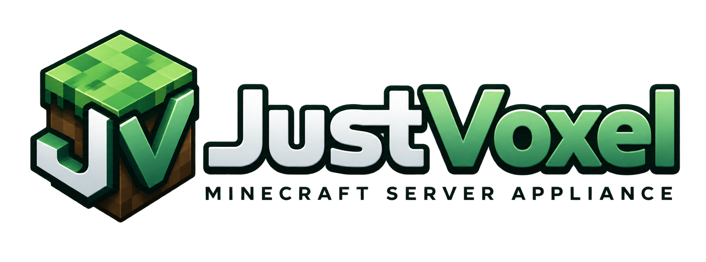

  

  <a href="../README.md">English</a> •
  <a href="README_fr-CA.md">Français (Canada)</a> •
  <a href="README_fr-FR.md">Français (France)</a> •
  <a href="README_de.md">Deutsch</a> •
  <a href="README_pl.md">Polski</a> •
  <a href="README_pt-BR.md">Português (Brasil)</a> •
  <a href="README_es-419.md">Español (Latinoamérica)</a> •
  <a href="README_es-ES.md">Español (España)</a> •
  <a href="README_it.md">Italiano</a> •
  <a href="README_nl.md">Nederlands</a> •
  <a href="README_sv.md">Svenska</a> •
  <a href="README_nb.md">Norsk Bokmål</a> •
  <a href="README_da.md">Dansk</a> •
  <a href="README_tr.md">Türkçe</a> •
  <a href="README_id.md">Bahasa Indonesia</a> •
  <a href="README_uk.md">Українська</a> •
  <a href="README_ru.md">Русский</a> •
  <a href="README_zh-Hans.md">简体中文</a> •
  <a href="README_zh-Hant.md">繁體中文</a> •
  <a href="README_ja.md">日本語</a> •
  <a href="README_ko.md">한국어</a>

<!-- justvoxel-translation-notice -->

> **О переводе:** Этот перевод JustVoxel подготовлен на основе исходного английского текста с помощью ИИ. Если вы заметите неточную, неясную или неестественную формулировку, предложите исправление через [сообщение о проблеме на GitHub](https://github.com/home-server-project/justvoxel/issues) или [запрос на внесение изменений (pull request)](https://github.com/home-server-project/justvoxel/pulls).

  <strong>Ваши серверы Minecraft. Своё оборудование, арендованный выделенный сервер или виртуальная машина у хостера. Единый центр управления.</strong>

  Готовая платформа для тех, кто хочет самостоятельно разместить сервер Minecraft и управлять игрой, не тратя время на администрирование операционной системы.

  <a href="#-установка-justvoxel">Установка</a> •
  <a href="#-свой-хостинг-minecraft-без-лишних-сложностей">Возможности</a> •
  <a href="../docs/INSTALLER.md">Документация</a>

  

JustVoxel — специализированная платформа для самостоятельного размещения серверов Minecraft. Установите её на совместимый ПК, ноутбук, физический сервер, виртуальную машину или на хостинг, который позволяет использовать собственный образ ОС. После этого управлять Minecraft можно из браузера.

Вам не придётся поддерживать набор скриптов или отдельно устанавливать панель управления Minecraft.

Есть старый ноутбук или ПК? **С JustVoxel HWS он может стать выделенным сервером Minecraft, даже если давно лежит без дела.** На поддерживаемых ноутбуках можно отключить переход в спящий режим при закрытии крышки, чтобы сервер продолжал работать. Экран локальной консоли можно погасить сразу или с небольшой задержкой.

> 🚧 **Предварительная версия.** JustVoxel готовится к первому публичному выпуску. Текущий установочный ISO-образ доступен для тестирования и раннего использования. Заключительные проверки перед выпуском ещё идут.

## ✨ Свой хостинг Minecraft без лишних сложностей

JustVoxel объединяет управление Minecraft и операционной системой, на которой он работает.

- 🎮 **Несколько серверов Minecraft** — запускайте разные миры и серверы разных типов независимо друг от друга на одной машине.
- 🖥️ **Центр управления в браузере** — управляйте серверами с компьютера, планшета или телефона.
- 🧩 **Плагины и моды** — находите совместимые дополнения в поддерживаемых каталогах и управляйте ими.
- 💾 **Резервное копирование и восстановление** — создавайте резервные копии каждого сервера вручную и по расписанию.
- 🌐 **Удалённый доступ** — выбирайте один из четырёх встроенных вариантов для частного доступа или создания игровых туннелей.
- 🤖 **ИИ и автоматизация** — подключайте совместимых ИИ-ассистентов и приложения через MCP и REST.
- 💬 **Telegram и Discord** — при желании управляйте сервером через ботов, получайте уведомления и организуйте работу сообщества.
- 🛡️ **Управление системой** — настраивайте сеть и хранилище, управляйте обновлениями, проверяйте состояние системы, просматривайте журналы и выполняйте поддерживаемые операции с питанием без изучения команд Linux.

JustVoxel подойдёт семьям, компаниям друзей, небольшим сообществам Minecraft и всем, кто предпочитает собственный сервер традиционному Minecraft-хостингу с арендованной панелью управления.

## 🖥️ Одна платформа, две редакции

### JustVoxel VM

Для виртуальных машин и сред виртуального хостинга, в том числе:

- Proxmox
- KVM / libvirt
- VMware
- Hyper-V
- VirtualBox
- виртуальных машин у хостеров и VPS, где можно установить собственный совместимый образ ОС

Редакция VM включает всю платформу Minecraft за исключением пакетов для физического оборудования, которые не нужны в виртуальной машине.

### JustVoxel HWS

Для установки непосредственно на физическое оборудование, например:

- старый ноутбук
- настольный компьютер, которому нашлось новое применение
- мини-ПК
- домашний сервер
- арендованный физический сервер, если хостер разрешает использовать свой установочный носитель

В HWS добавлена поддержка физического оборудования: интеграция с ИБП через NUT, инструменты SMART и NVMe, датчики, средства управления прошивкой и UEFI, прошивки устройств, диагностика оборудования, управление экраном ноутбука и реакцией на закрытие крышки.

Обе редакции используют один и тот же центр управления JustVoxel и Management API. Работа с Minecraft, организация хранения данных, резервное копирование, настройка сети и обновления в них одинаковы.

[Подробнее о возможностях VM и HWS](../docs/VARIANTS.md)

## 🚀 Установка JustVoxel

Для обеих редакций JustVoxel используется один установочный ISO-образ.

[⬇️ Скачать ISO-образ JustVoxel для x86_64](https://sourceforge.net/projects/justvoxel/files/JustVoxel-x86_64.iso/download)

Выберите редакцию в зависимости от того, куда вы устанавливаете систему:

- **JustVoxel VM** — для виртуальных машин, в том числе на совместимом виртуальном хостинге
- **JustVoxel HWS** — для ПК, ноутбуков, мини-ПК, физических домашних серверов и совместимых выделенных физических серверов у хостеров

Подготовка дисков, установка и первый вход описаны в [руководстве по установке](../docs/INSTALLER.md).

## 🏠 В первую очередь для Minecraft, но не только

JustVoxel разрабатывается и поддерживается прежде всего как платформа для серверов Minecraft. В её основе — обычный **сервер AlmaLinux 10 bootc с Podman, Quadlet, systemd, SSH, NetworkManager и стандартными средствами администрирования Linux**.

Опытные пользователи могут использовать ту же машину как многоцелевой домашний сервер и запускать дополнительные контейнеры рядом с Minecraft.

Например, вручную можно развернуть:

- **Jellyfin** или **Plex** для медиатеки
- **Vaultwarden** для управления паролями
- **Immich** для работы с фото и видео
- **Home Assistant Container** для домашней автоматизации
- **Nextcloud** для хранения файлов и совместной работы
- **Syncthing** или **Navidrome**
- **OpenClaw** в качестве ИИ-агента или шлюза на собственном сервере

Эти приложения **не управляются через центр управления JustVoxel**. Администратор самостоятельно отвечает за их контейнеры Podman, конфигурации Quadlet, хранилища, порты, обновления, резервные копии, настройку обратного прокси и соблюдение требований каждого приложения.

JustVoxel управляет платформой Minecraft. Для остальных задач опытным пользователям доступны привычные средства Podman и Quadlet.

При обслуживании JustVoxel учитывает, что сторонними контейнерами управляет администратор и они не относятся к ресурсам Minecraft. Такие операции, как **«Начать заново» (Start Over)** для Minecraft, не удаляют посторонние контейнеры Podman.

Таким образом, машина с JustVoxel может оставаться прежде всего платформой для Minecraft и при желании выполнять функции обычного домашнего сервера с контейнерами.

## 🎮 Создайте свой сервер Minecraft

JustVoxel может одновременно запускать несколько независимых серверов Minecraft, если на машине достаточно памяти и есть свободные порты.

У каждого сервера свои идентификатор, конфигурация, среда выполнения, порты, данные, резервные копии, средства управления жизненным циклом и сведения о состоянии.

### Поддерживаемое серверное ПО

| Серверное ПО | Тип дополнений | Совместная игра Java → Bedrock средствами JustVoxel |
| --- | --- | --- |
| **Paper** | Плагины | ✅ |
| **Purpur** | Плагины | ✅ |
| **Spigot** | Плагины | ✅ |
| **Pufferfish** | Плагины | ✅ |
| **Leaf** | Плагины | ✅ |
| **Fabric** | Моды | ✅ При подтверждённой совместимости конкретных версий |
| **NeoForge** | Моды | ✅ При подтверждённой совместимости конкретных версий |
| **Forge** | Моды | Только Java |
| **Quilt** | Моды | Только Java |
| **Vanilla Java** | Без плагинов и модов | Только Java |
| **Native Bedrock** | Нативный сервер Bedrock | Нативные клиенты Bedrock |

Выберите **простую настройку (Simple Setup)**, чтобы создать первый сервер по шагам. **Расширенная настройка (Advanced Setup)** даёт больше контроля над памятью, портами, хранилищем, резервным копированием, правилами выбора версий и совместной игрой там, где она поддерживается.

JustVoxel проверяет доступность каждой функции для выбранного серверного ПО.

[Подробнее о серверном ПО и совместимости](../docs/server-software.md)

## 🧩 Плагины и моды

Для выбранного сервера откройте раздел **Minecraft → Плагины и моды**.

В зависимости от типа сервера JustVoxel может использовать:

- [Modrinth](https://modrinth.com/)
- [Hangar](https://hangar.papermc.io/)
- [CurseForge](https://www.curseforge.com/minecraft) с указанным вами ключом API

При установке поддерживаемых дополнений JustVoxel проверяет совместимость и загруженные файлы, создаёт резервные копии при остановленном сервере, проверяет перезапуск, отслеживает принадлежность файлов и предусматривает меры для восстановления.

Серверы семейства Paper могут использовать каталоги плагинов. Fabric, Forge, NeoForge и Quilt используют каталоги модов с проверкой точного соответствия загрузчику и версии Minecraft. Для Vanilla Java и нативного Bedrock каталог плагинов и модов не предусмотрен.

[Подробнее о плагинах и модах](../docs/plugin-workspace.md)

## 🌐 Minecraft Network по желанию

Несколько серверов могут работать независимо друг от друга. Прокси для этого **не требуется**.

Если нужна единая публичная точка входа на несколько совместимых серверов, в JustVoxel можно настроить **Minecraft Network** на базе Velocity.

В центре управления можно выбрать поддерживаемые игровые серверы для подключения к прокси, настроить публичные порты Java и Bedrock, управлять виртуальным лобби, приветственным сообщением и составом сети.

В Minecraft Network можно включать серверы Paper, Purpur, Pufferfish и Leaf. Серверы Fabric/Quilt и Forge/NeoForge также можно подключить, если JustVoxel подтвердит необходимую совместимость с прокси. Spigot, Vanilla и нативный Bedrock работают самостоятельно.

[Подробнее о Minecraft Network](../docs/minecraft-network.md)

## 🖥️ Знакомство с центром управления

В JustVoxel всё организовано вокруг задач владельца сервера. Чтобы с ними справиться, не нужно разбираться во внутреннем устройстве Linux.

### Серверы Minecraft

Создавайте несколько серверов, запускайте и останавливайте их, проверяйте состояние и список игроков, меняйте поддерживаемые настройки и пользуйтесь инструментами для конкретного сервера.

### Плагины и моды

Находите совместимые дополнения, просматривайте установленные плагины и моды, управляйте поддерживаемыми дополнениями и получайте сведения о восстановлении, если после изменения требуется ваше вмешательство.

### Резервные копии и хранилище

Создавайте резервные копии, просматривайте их историю, восстанавливайте все данные сервера, выбирайте места хранения копий, импортируйте и экспортируйте серверы и управляйте поддерживаемыми хранилищами.

### Сеть

Настраивайте Ethernet, Wi-Fi и удалённый доступ, пользуйтесь средствами **диагностики подключения**. Для изменений, которые могут прервать связь, предусмотрен откат, чтобы ошибка в настройках IP или Wi-Fi не привела к постоянной потере доступа.

### Система

Проверяйте состояние системы, использование ресурсов, журналы и обновления ОС. Управляйте пользователями, настройками безопасности и питанием в пределах поддерживаемых операций. В редакции HWS также доступно управление оборудованием.

### Подключения ИИ и API

Подключайте поддерживаемые ИИ-приложения, клиенты MCP, средства автоматизации через REST, Telegram и Discord без развёртывания отдельной системы управления.

Предпочитаете терминал? В JustVoxel входит **mjust** — интерактивный интерфейс администрирования в терминале, в котором действуют те же правила безопасности.

[Документация веб-интерфейса](../docs/WEBUI.md) · [Руководство по mjust](../docs/MJUST.md)

## 🌐 Выберите, как друзья будут подключаться к серверу

В разделе **Сеть → Удалённый доступ** JustVoxel сейчас доступны четыре варианта подключения.

Для каждого сервиса JustVoxel предоставляет не только пакеты в составе образа, но и средства просмотра состояния, включения, отключения и настройки в зависимости от возможностей сервиса.

| Сервис | Для каких задач подходит | Что даёт |
| --- | --- | --- |
| **[Tailscale](https://tailscale.com/)** | Частные серверы для друзей и семьи | Частная ячеистая сеть между одобренными устройствами |
| **[NetBird](https://netbird.io/)** | Частные сети с управляемым доступом | Частная сеть с управлением учётными записями и политиками доступа |
| **[Playit.gg](https://playit.gg/)** | Публичный доступ к Minecraft без обычной переадресации портов на маршрутизаторе | Публичные игровые туннели и адреса для подключения |
| **[NordVPN Meshnet](https://meshnet.nordvpn.com/)** | Частный доступ между устройствами пользователей NordVPN | Подключение через Meshnet без использования JustVoxel в качестве клиента коммерческого VPN |

### Какой вариант выбрать?

**🎮 Хотите, чтобы друзья могли играть без установки клиента частной VPN-сети?**  
Начните с **Playit.gg**. Игроки смогут подключаться по публичному адресу настроенного вами игрового туннеля.

**🔒 Нужен частный сервер для доверенных устройств?**  
Рассмотрите **Tailscale** или **NetBird**.

**🌍 Уже пользуетесь NordVPN Meshnet?**  
JustVoxel позволяет управлять подключением к Meshnet. Подключение устройства к обычному выходному серверу коммерческого сервиса NordVPN — отдельная задача.

Учётные записи, облачные политики и настройки туннелей по-прежнему находятся на стороне провайдера. JustVoxel отвечает за поддерживаемую часть интеграции на самом устройстве.

Можно использовать несколько VPN-сервисов или ячеистых сетей одновременно, но при этом возможны конфликты маршрутизации, DNS или правил межсетевого экрана.

[Руководство по сети и удалённому доступу](../docs/NETWORKING.md)

## 🤖 ИИ, MCP, REST и автоматизация

Хотите спросить у ИИ-ассистента о состоянии сервера, подключить домашнюю автоматизацию или создать собственный сценарий управления?

В разделе **Подключения ИИ и API** доступны встроенные **интерфейсы MCP и REST**.

При настройке можно выбрать совместимое приложение или тип подключения, в том числе:

- **OpenAI — ChatGPT и Codex**
- **Claude**
- **Grok**
- **Gemini**
- **GitHub Copilot**
- **Другое приложение ИИ / MCP**
- **Автоматизация / REST API**

Вы сами определяете, к чему получит доступ каждое подключение.

Доступные права начинаются с **уровня 1 — только чтение** и включают управление серверами. Расширенное управление системой требует явного разрешения. Доступ через конкретное подключение также можно ограничить выбранными серверами Minecraft.

Чтобы предоставить интерфейс MCP или REST, JustVoxel не нужен ключ API для ИИ-модели. Возможность подключения конкретного клиента зависит от приложения, возможностей учётной записи или подписки и доступа к сети.

По умолчанию шлюз ИИ/API отключён. Для работы его нужно включить.

[Подробнее о подключениях ИИ и API](../docs/AI-API-CONNECTIONS.md)

## 💬 Telegram и Discord

В JustVoxel встроены необязательные интеграции с Telegram и Discord. Они используют ту же серверную службу, которая отвечает за операции управления в веб-интерфейсе.

### Telegram

Через отдельного Telegram-бота можно:

- проверять состояние платформы и Minecraft
- выбирать сервер и просматривать сведения об игроках
- запускать, останавливать и перезапускать сервер при наличии прав управления
- создавать резервные копии вручную
- просматривать сведения об обновлениях Minecraft и контейнеров
- получать информацию об обновлениях ОС
- выполнять контролируемую перезагрузку системы
- по желанию получать уведомления о состоянии сервера, результатах резервного копирования и доступности обновлений

В Telegram действуют собственные права **«Только чтение»** и **«Управление сервером»**. ИИ-модель для работы бота не требуется.

[Настройка Telegram и права доступа](../docs/TELEGRAM.md)

### Discord

Через Discord участники сообщества могут взаимодействовать с сервером Minecraft, а администраторы — управлять им.

Участники явно привязанного сервера Discord могут просматривать основные сведения о состоянии сервера и запрашивать доступ к Minecraft. Права администратора при этом автоматически не выдаются.

Пользователи Discord, которым разрешено администрировать JustVoxel, могут запускать, останавливать и перезапускать сервер, создавать резервные копии вручную, просматривать обновления, управлять Minecraft Network и выполнять дополнительные расширенные операции.

Участие в сообществе Discord, включение в список разрешённых игроков Minecraft и право администрировать JustVoxel предоставляются отдельно.

[Настройка Discord, доступ для сообщества и администрирование](../docs/DISCORD.md)

## 💾 Резервное копирование, восстановление, хранение и перенос данных

Данные Minecraft важнее образа системы.

JustVoxel хранит данные Minecraft и резервные копии вне неизменяемого образа развёрнутой ОС. Место хранения для них можно выбрать по отдельности.

Поддерживаются следующие варианты хранения:

- системная файловая система
- отдельные внутренние диски
- USB-накопители
- существующие локальные разделы и файловые системы
- новые разделы, созданные из уже имеющегося неразмеченного пространства
- NFS
- SMB/CIFS

Для каждого сервера можно создавать резервные копии автоматически и вручную. При восстановлении все постоянные данные выбранного сервера заменяются данными из копии. При этом сохраняются идентификатор сервера в JustVoxel и его конфигурация на платформе.

Для переноса серверов между машинами или при переустановке JustVoxel также предоставляет проверенные процедуры **экспорта, импорта и восстановления**.

[Хранение данных](../docs/STORAGE.md) · [Восстановление](../docs/RESTORE.md) · [Перенос](../docs/MIGRATION.md)

## 🛡️ Безопасное внесение изменений

Веб-интерфейс JustVoxel не позволяет выполнять произвольные команды оболочки.

Для поддерживаемых операций на уровне платформы предусмотрены следующие меры защиты:

- проверка присутствия игроков перед действиями, которые могут прервать игру
- просмотр изменений перед нажатием «Применить»
- резервное копирование при остановленном сервере, если после изменений может понадобиться восстановление
- однозначная идентификация каждого сервера, исключающая случайную подмену другим
- проверка перезапуска и работы сервера
- сохранение состояния операций и восстановления между запусками
- возможность отката поддерживаемых операций
- контрольные точки NetworkManager при рискованных изменениях сети
- отдельные процедуры обновления Minecraft и операционной системы

Веб-интерфейс, с которым работает браузер, не имеет повышенных привилегий. Для изменений, требующих таких прав, используется локальная служба JustVoxel Management Agent с явно определённым API. У браузера нет доступа к командной оболочке root.

## 🔄 Раздельные обновления системы и Minecraft

JustVoxel — платформа на базе Home Server Base 10 / AlmaLinux 10, которая обновляется целыми образами.

Обновления операционной системы выполняются отдельно от смены версий Minecraft, обновлений серверного ПО, плагинов, модов и контейнеров.

При обновлении платформы версия Minecraft не меняется без вашего ведома, а изменения на сервере Minecraft не требуют пересборки операционной системы хоста.

[Документация по управлению системой](../docs/SYSTEM.md)

## 📊 Сравнение JustVoxel с другими решениями

JustVoxel отличается от традиционных панелей управления Minecraft тем, что **операционная система и средства управления Minecraft составляют единую серверную платформу**.

| Возможность | **JustVoxel** | **MineOS SvelteKit** | **Crafty Controller** | **MineOS Node** |
| --- | :---: | :---: | :---: | :---: |
| Полноценная специализированная ОС для сервера Minecraft | ⭐ | — | — | — |
| Несколько серверов Minecraft | ✅ | ✅ | ✅ | ✅ |
| Поддержка серверов Java и Bedrock | ✅ | ✅ | ✅ | 🟡 Java и поддержка устаревшего PocketMine |
| Встроенный поиск плагинов и модов | ✅ Modrinth, Hangar, CurseForge | ✅ Modrinth, CurseForge | — | — |
| Управление сетью, хранилищем и ОС хоста | ⭐ | — | — | — |
| Встроенный частный доступ и игровые туннели | ⭐ 4 варианта | — | — | — |
| Шлюз MCP и REST для ИИ и автоматизации | ⭐ | — | — | — |
| Встроенное управление через Telegram и Discord | ⭐ | — | — | — |
| Управление экраном ноутбука и реакцией на закрытие крышки | ✅ HWS | — | — | — |
| Обновление неизменяемой ОС целыми образами | ✅ | — | — | — |
| Управление из терминала | ✅ mjust | ✅ mineos CLI/TUI | — | ✅ CLI |
| Способ установки | Готовая серверная система на базе bootc | Приложение Docker / Compose | Панель управления в Docker, Linux или Windows | Приложение Node.js для Linux/BSD |

⭐ отличительная возможность &nbsp;•&nbsp; ✅ поддерживается &nbsp;•&nbsp; 🟡 частичная или устаревшая поддержка &nbsp;•&nbsp; — не описано в рассмотренной основной документации проекта

**Дата последней проверки сравнения — 16 ноября 2026 года.** Цель сравнения — помочь с выбором, а не объявить другие проекты «плохими». MineOS и Crafty — приложения для управления Minecraft, которые могут отлично подойти, если у вас уже есть операционная система и вы хотите администрировать её самостоятельно. JustVoxel рассчитан на тех, кто хочет управлять панелью Minecraft **и всей серверной платформой под ней** как единым продуктом.

Сравнение опирается на актуальную документацию и репозитории проектов:

- [MineOS SvelteKit](https://github.com/freeman412/mineos-sveltekit)
- [Crafty Controller](https://craftycontrol.com/) · [исходный код](https://gitlab.com/crafty-controller/crafty-4)
- [MineOS Node](https://github.com/hexparrot/mineos-node)

Если какой-то пункт сравнения устарел или неточно описывает проект, откройте задачу в репозитории. Исправления приветствуются и тогда, когда сравнение окажется не в пользу JustVoxel.

## 📚 Документация

Подробные руководства по работе с платформой собраны в [каталоге документации](../docs/).

С чего начать:

- [Веб-интерфейс](../docs/WEBUI.md)
- [Среда выполнения Minecraft](../docs/MINECRAFT_RUNTIME.md)
- [Серверное ПО](../docs/server-software.md)
- [Плагины и моды](../docs/plugin-workspace.md)
- [Minecraft Network](../docs/minecraft-network.md)
- [Сеть и удалённый доступ](../docs/NETWORKING.md)
- [Подключения ИИ и API](../docs/AI-API-CONNECTIONS.md)
- [Telegram](../docs/TELEGRAM.md)
- [Discord](../docs/DISCORD.md)
- [Хранение данных](../docs/STORAGE.md)
- [Восстановление](../docs/RESTORE.md)
- [Перенос](../docs/MIGRATION.md)
- [Управление системой](../docs/SYSTEM.md)
- [mjust](../docs/MJUST.md)

Разработка образов, тестирование и подготовка выпусков описаны в [руководстве разработчика](../README-DEV.md).

## ⛏️ Серверное ПО Minecraft и лицензионное соглашение

JustVoxel **не включает** исполняемые файлы сервера Minecraft, серверное ПО Mojang, заранее созданный мир или заранее принятое лицензионное соглашение Minecraft (EULA).

При создании сервера администратор принимает лицензионное соглашение Minecraft, после чего JustVoxel подготавливает выбранную поддерживаемую среду выполнения сервера Minecraft.

На Minecraft, программное обеспечение Mojang, Paper, Purpur, Spigot, Pufferfish, Leaf, Fabric, NeoForge, Forge, Quilt, плагины, моды и другие сторонние компоненты распространяются их собственные лицензии и условия распространения.

## 📄 Лицензия

JustVoxel распространяется по лицензии **Apache-2.0**. См. [LICENSE](../LICENSE).

Уведомления о сторонних компонентах приведены в файле [THIRD_PARTY_NOTICES.md](../THIRD_PARTY_NOTICES.md).
